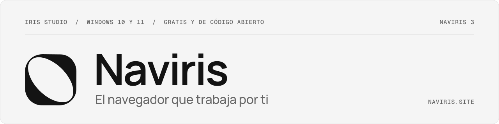
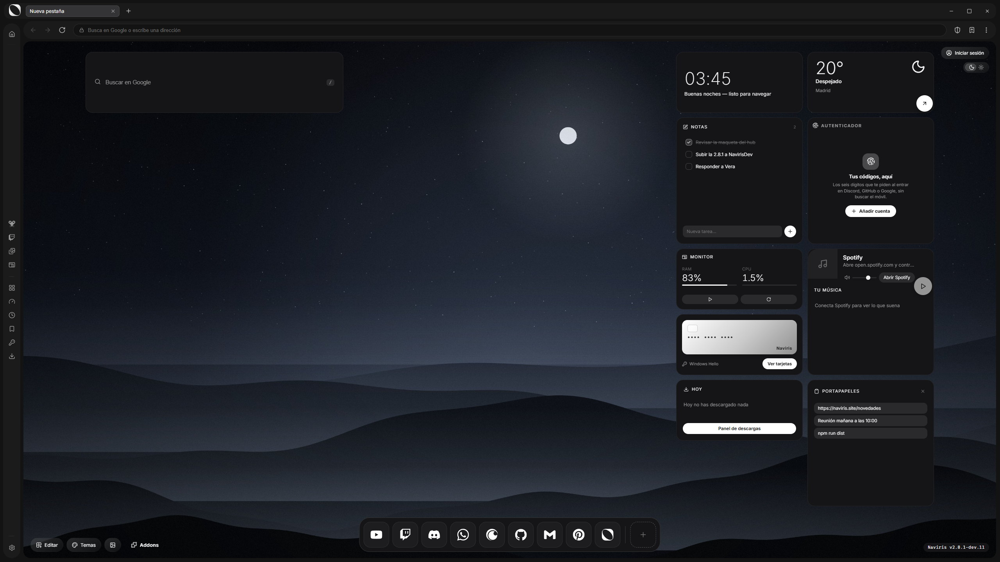
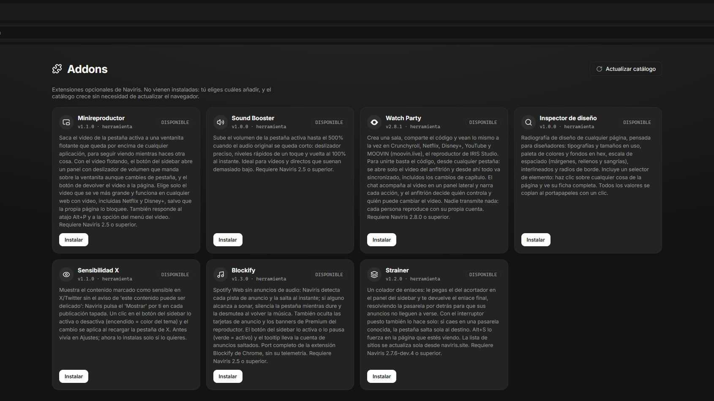

<p align="center">
  <a href="https://naviris.site">
    <picture>
      <source media="(prefers-color-scheme: dark)" srcset="assets/banner-oscuro.svg">
      <source media="(prefers-color-scheme: light)" srcset="assets/banner-claro.svg">
      
    </picture>
  </a>
</p>

<p align="center">
  <a href="https://github.com/DosaAKA2A/Naviris/releases/latest"></a>
  <a href="https://github.com/DosaAKA2A/Naviris/actions/workflows/pruebas.yml"></a>
  <a href="LICENSE"></a>
  
</p>

<p align="center">
  <a href="https://github.com/DosaAKA2A/Naviris/releases/latest"><b>Descargar</b></a>
  &nbsp;·&nbsp; <a href="https://naviris.site">naviris.site</a>
  &nbsp;·&nbsp; <a href="CHANGELOG.md">Novedades</a>
  &nbsp;·&nbsp; <a href="PERFORMANCE.md">Rendimiento</a>
  &nbsp;·&nbsp; <a href="SEGURIDAD.md">Seguridad</a>
</p>

Naviris es un navegador para Windows hecho sobre Chromium. Trae dentro lo que en otros navegadores tendrías que instalar aparte: bloqueador de anuncios, descargas de video y audio, drops de Twitch en segundo plano y salas para ver series con tus amigos. Es gratis, de código abierto y lo hace IRIS Studio.



## Qué trae

**AutoClaim.** Deja un canal de Twitch abierto de fondo, sin sonido y a la resolución mínima, y Naviris reclama solo los puntos y los drops.

**Rat Tool.** Detecta el video de la página y lo baja en MP4, o solo el audio en MP3, con la calidad que elijas. Funciona con YouTube, Instagram, X, TikTok (sin marca de agua), Twitch y más. La primera vez que lo abres baja yt-dlp, ffmpeg y Deno, que es lo que usa por dentro.

**Watch Party.** Comparte un código y la reproducción queda sincronizada para todos, también al cambiar de capítulo, con un chat al lado. Va con Crunchyroll, Netflix, Disney+, YouTube y MOOVIN, y cada quien entra con su propia cuenta.

**Espacios protegidos.** Cada espacio agrupa sus pestañas, su historial y sus marcadores. Si le pones un código, además tiene su propia sesión, que sigue separada al cerrar Naviris o reiniciar el equipo.

**Bloqueador de anuncios.** Viene activado y sus listas se actualizan solas. Puedes permitir anuncios en un sitio concreto, y en YouTube salta los anuncios sin frenar el video.

**Un hub que montas tú.** La página de inicio es una cuadrícula de widgets (reloj, buscador, clima, notas, tendencias y más) con el fondo y el tema que quieras. Si cambias el tamaño de la ventana, nada se reordena.

También vienen de fábrica:

- un gestor de contraseñas cifrado con tu cuenta de Windows, que pide Windows Hello (PIN, huella o cara) para enseñar cada una;
- un autenticador para tus códigos de verificación;
- pestañas en vertical, pantalla dividida y ventana privada;
- pestañas que se duermen solas cuando no las usas, para ahorrar memoria;
- paneles laterales con WhatsApp, Discord, Gmail, Spotify y otros;
- Google Lens, video protegido con Widevine y un detector de las imágenes y recursos de la página para verlos y bajarlos;
- el contenido marcado como sensible en X, visible sin pasos de más;
- búsqueda con autocompletado desde tu historial;
- marcadores con carpetas, que puedes importar desde Chrome, Edge, Opera GX o Firefox;
- una cuenta Naviris opcional para sincronizar preferencias, marcadores y el hub (las contraseñas no salen nunca de tu equipo);
- un catálogo de addons opcionales y firmados;
- actualizaciones automáticas al cerrar, que puedes apagar.



## Rendimiento

Medido el 11 de noviembre de 2026 en un Ryzen 7 9800X3D con 32 GB, frente a Chrome 157 y Brave 1.99, un navegador a la vez y con varias repeticiones. Las cifras son medianas.

| | Naviris | Chrome | Brave |
|---|---|---|---|
| Memoria con 10 sitios al fondo | 1803 MB | 1939 MB | 1821 MB |
| Procesos con 10 sitios | 19 | 29 | 23 |
| LCP sumado de 10 sitios | 6,4 s | 7,3 s | 7,9 s |
| Speedometer 3.1 | 40,0 | 41,2 | 38,4 |
| Memoria en reposo | 347 MB | 261 MB | 253 MB |
| Ventana visible al abrir | 1,29 s | 0,17 s | 0,19 s |

Naviris va con su bloqueador activado, igual que Brave con Shields. Con el bloqueador apagado, frente a Chrome, queda a la par en memoria y en carga. Al abrir, la ventana sale más tarde porque la animación de arranque dura como mínimo 1,05 s, y en reposo gasta unos 85 MB más, casi todo en la GPU. El método, todas las tablas y lo que falta por medir están en [PERFORMANCE.md](PERFORMANCE.md), y los guiones para repetirlo, en [`benchmark/`](benchmark/).

## Instalar

Baja el instalador o la versión portable de la [última release](https://github.com/DosaAKA2A/Naviris/releases/latest) o de [naviris.site](https://naviris.site). Funciona en Windows 10 y 11 de 64 bits. El instalador no lleva firma de código, así que SmartScreen puede avisarte la primera vez: elige «Más información» y luego «Ejecutar de todas formas».

Para Android hay una app aparte, más sencilla, con el Rat Tool, los marcadores y el bloqueador. Se baja desde naviris.site.

Cómo se guardan tus datos, qué se revisó y qué queda pendiente está en [SEGURIDAD.md](SEGURIDAD.md).

## Desarrollo

Necesitas Node 24, Git y Rust: `adblock-rs` se compila al instalar. Con [rustup](https://rustup.rs) basta, porque la versión la fija su `rust-toolchain.toml`.

```bash
npm install
npm run fetch-bin   # baja yt-dlp.exe, ffmpeg.exe y deno.exe a resources/bin
npm start
```

`electron` es el de castlabs (con Widevine) y viene de GitHub por git, apuntado por SSH en `package-lock.json`. Si no tienes clave SSH, haz que git use https antes de instalar:

```bash
git config --global url."https://github.com/".insteadOf "ssh://git@github.com/"
```

En Ajustes está el **modo agente**: abre CDP en `127.0.0.1:9223` para automatizar Naviris desde fuera. Mientras está encendido, cualquier programa del equipo puede controlarlo sin pedir clave, así que conviene apagarlo cuando no se usa.

### Estructura

| Carpeta | Qué hay |
|---|---|
| `src/` | El navegador: proceso principal (`main.js`), interfaz y preloads |
| `test/` | Pruebas unitarias; las que arrancan la app real están en `test/e2e/` |
| `build/` | Iconos, firma, empaquetado y publicación |
| `addons/` | Catálogo de addons y su firma |
| `resources/adblock/` | Recursos del bloqueador (scriptlets y sustitutos) |
| `watchparty/` | Servidor de Watch Party ([README](watchparty/README.md)) |
| `sync/` | Servidor de la cuenta Naviris |
| `mobile/` | La app de Android |
| `novedades/` | Las notas de cada versión que enseña la app |
| `benchmark/` | Los guiones de [PERFORMANCE.md](PERFORMANCE.md) |
| `index.html`, `assets/` | La web de [naviris.site](https://naviris.site), servida desde `main` por GitHub Pages |

### Pruebas

```bash
npm run check             # node --check de src/, build/ y benchmark/
npm test                  # pruebas unitarias, sin abrir la app
npm run test:e2e:ci       # la app real, sin red de terceros ni cuentas (repite una vez el archivo que falle)
npm run test:e2e          # todas las de la app real, también las que necesitan YouTube, X o el servidor de Watch Party
npm run test:e2e:adblock  # el bloqueador contra sitios reales
```

Las pruebas con la app real arrancan Naviris con un perfil temporal propio y hablan con ella por CDP. El puerto se elige con `NAVIRIS_E2E_PUERTO` (y `NAVIRIS_E2E_PORT` para la de perfiles). `test/actualizador.test.js` pasa los feeds que genera el publicador por el mismo electron-updater de la app, contra un GitHub simulado: comprueba versión, sha512, tamaño y nombre, y que una estable nunca recibe una dev.

En GitHub, el workflow **Pruebas** (`.github/workflows/pruebas.yml`) corre `npm run check`, `npm test` y `npm run test:e2e:ci` en Windows en cada push y pull request a `main` y `v3`. El binario de Electron se baja aparte con `node node_modules/electron/install.js`, `adblock-rs` se compila con el Rust del runner y la firma VMP de Widevine no hace falta para probar.

### Otros scripts

| Script | Para qué |
|---|---|
| `npm run adblock-recursos` | Rehace los recursos del bloqueador en `resources/adblock/` |
| `npm run firma:addons` | Firma el catálogo de addons |
| `npm run icon`, `npm run icon-ico` | Generan `build/icon.png` y `build/icon.ico` |

## Canales y publicación

Naviris tiene dos líneas que no se cruzan:

- **Estable** (versiones como `3.0.0`): release normal de GitHub con el feed `latest.yml`. Las instalaciones estables solo ven estables.
- **Dev** (versiones con `-dev`, como `3.0.0-dev.1`; la instalación se llama NavirisDev): release marcada como *prerelease* con el feed `dev.yml`. Las instalaciones dev solo ven devs.

Desde el menú, en las actualizaciones, se puede instalar a mano la última de la otra línea. Quién escucha qué está en `src/canal-actualizaciones.js`; el feed y sus comprobaciones, en `build/feed-actualizador.js`. Cada versión publicada tiene su entrada en [CHANGELOG.md](CHANGELOG.md) y sus notas en `novedades/`.

Para publicar:

1. Sube la versión en `package.json` y añade su entrada en `CHANGELOG.md` y en `novedades/`.
2. Exporta un token de GitHub con permiso `repo` (`GH_TOKEN`).
3. `npm run release`: compila con la firma VMP (`npm run dist`, que deja el instalador NSIS y el portable en `dist/`) y luego corre `build/publish-release.js`, que:
   - corre `npm test` y **no publica si falla**;
   - genera el feed de su línea (`latest.yml` o `dev.yml`, nunca los dos) y comprueba que cuadra con el instalador y que la release está marcada como prerelease solo si es dev;
   - sube instalador, portable, blockmap y feed, y vuelve a comprobar el feed tal como lo sirve GitHub.

No se usa `electron-builder --publish`: sus dos publicadores (instalador y portable) chocan y dejan la release a medias.

Solo en una emergencia se puede publicar sin pruebas con `NAVIRIS_PUBLICAR_SIN_PRUEBAS=1`; el script lo avisa en la salida. El workflow **Desktop Release** solo compila (sin firma VMP, no se distribuye) y no arranca si **Pruebas** falla.

## Licencia

MIT © IRIS Studio
